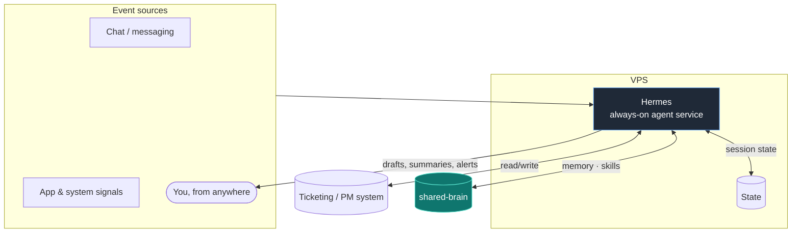

# Architecture

Hermes was a single **always-on service** on a VPS: not a fleet, not an
on-demand tool. The architecture was shaped entirely by that one fact: it had
to stay up, react to events, and be reachable from anywhere.

Like every body in this system, Hermes kept no knowledge of its own. Memory,
skills and agent definitions lived in
[`shared-brain`](https://github.com/soeren90/shared-brain), the plain-Markdown
substrate it shared with [`larry`](https://github.com/soeren90/larry) and the
bodies that came after it.

## The loop

Hermes ran a continuous loop rather than a one-shot session:

1. **Listen** for inbound messages and app/system signals.
2. **Interpret** what an event *is*: a bug, a feature request, a question, a
   no-op.
3. **Act**: create or triage a ticket, draft an artifact, answer a question, or
   raise an alert. Anything decision-shaped or outbound was left as a draft.
4. **Remember**: persist state so context survived restarts and spanned
   conversations, and write durable learnings back to the shared brain.

## Why a service, not a session

A local agent starts fresh each time you invoke it. Hermes couldn't: product
work arrived unprompted and at all hours. That forced three things a one-shot
agent doesn't need:

- **Persistence.** Session state lived on the host and durable knowledge in the
  shared brain, so a restart or a crash didn't lose context.
- **Event intake.** It was wired to *receive* (a chat webhook, a polling loop,
  app signals), not just to be typed at.
- **Uptime as a feature.** If it was down, work silently didn't get captured. So
  the boring operational stuff (process supervision, restarts, logs) was part of
  the design, not an afterthought.

## Running it on a VPS

Self-hosting was a deliberate trade: **control in exchange for ownership**.

| You gain | You own |
| --- | --- |
| Full control of scope, data location, wiring | Keeping the box up |
| No platform limits on what it can touch | Security & patching |
| Predictable cost | Monitoring & recovery |

The operational model (process supervision, secrets handling, restart policy,
logging) is covered generically in [docs/deployment.md](docs/deployment.md).

## Safety boundaries

Same invariants as the rest of the system: scoped access only where needed,
drafts instead of unilateral sends, confirmed facts only, and every action
inspectable in the logs. An always-on agent with broad write access and no human
gate is a liability; Hermes was deliberately not that.

## Where the work went

In autumn 2026 the same trade was weighed again and came out the other way: an
always-online box holding credentials is a larger attack surface than agents
that run under my control. The work moved to locally running and scheduled
agents on the same brain, described in
[`shared-brain`](https://github.com/soeren90/shared-brain). Because nothing
lived only inside Hermes, retiring it was a change of body, not a loss of
memory.
