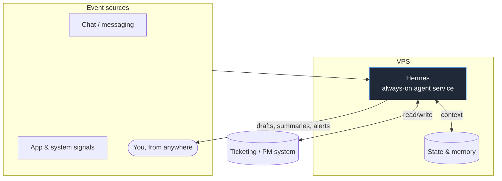

# Architecture

Hermes is a single **always-on service** on a VPS — not a fleet, not an
on-demand tool. The architecture is shaped entirely by that one fact: it has to
stay up, react to events, and be reachable from anywhere.

## The loop

Hermes runs a continuous loop rather than a one-shot session:

1. **Listen** — for inbound messages and app/system signals.
2. **Interpret** — decide what an event *is*: a bug, a feature request, a
   question, a no-op.
3. **Act** — create/triage a ticket, draft an artifact, answer a question, or
   raise an alert. Anything decision-shaped or outbound is left as a draft.
4. **Remember** — persist state so context survives restarts and spans
   conversations.

## Why a service, not a session

A local agent starts fresh each time you invoke it. Hermes can't — product work
arrives unprompted and at all hours. That forces three things a one-shot agent
doesn't need:

- **Persistence.** State and memory live on disk/db on the host, so a restart or
  a crash doesn't lose context.
- **Event intake.** It's wired to *receive* — a chat webhook, a polling loop, or
  app signals — not just to be typed at.
- **Uptime as a feature.** If it's down, work silently doesn't get captured. So
  the boring operational stuff (process supervision, restarts, logs) is part of
  the design, not an afterthought.

## Running it on a VPS

Self-hosting is a deliberate trade — **control in exchange for ownership**:

| You gain | You own |
| --- | --- |
| Full control of scope, data location, wiring | Keeping the box up |
| No platform limits on what it can touch | Security & patching |
| Predictable cost | Monitoring & recovery |

The operational details (process supervision, secrets handling, restart policy,
logging) are covered generically in [docs/deployment.md](docs/deployment.md).

## Safety boundaries

Same invariants as the rest of the setup: read/scoped access only where needed,
drafts instead of unilateral sends, confirmed facts only, and every action
inspectable in the logs. An always-on agent with broad write access and no human
gate is a liability; Hermes is deliberately not that.
